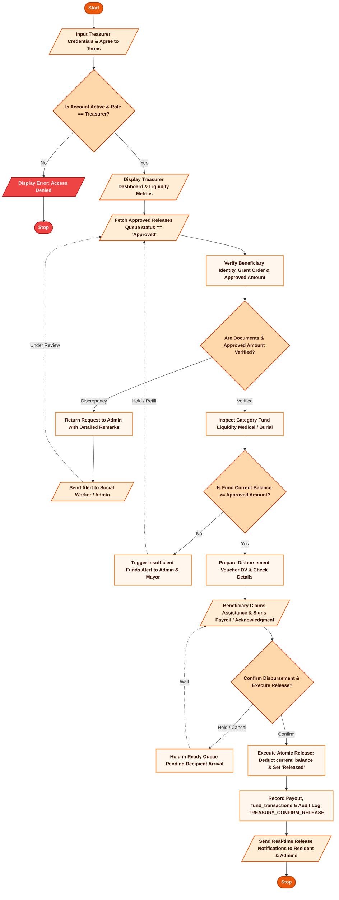

# AICS SYSTEM — MUNICIPAL TREASURER FLOW CHART & WORKFLOW SPECIFICATION
**Municipality of Daanbantayan, Cebu — Office of the Municipal Treasurer**
*Assistance to Individuals in Crisis Situations (AICS) Request Management and Beneficiary Information System*

---

## 📋 Executive Overview

This document specifies the role-exclusive operational workflow and decision logic for the **Municipal Treasurer** in the AICS Management System. The Treasurer functions as the municipal disbursing officer, responsible for verifying approved financial claims, preparing official Disbursement Vouchers (DV), enforcing municipal fund liquidity, executing atomic disbursements, maintaining the financial ledger, and producing regulatory liquidation reports for COA and DSWD.

---

## 🎨 Visual Flowchart Access & Formats

This documentation is available in three presentation formats:
1. **Interactive Vector Graphic**: Open **[FLOW CHART - TREASURER.html](file:///c:/Users/John%20Kyle/Desktop/AICS-System/FLOW%20CHART%20-%20TREASURER.html)** in any browser for interactive zoom, vector rendering, and single-click printing or PDF export.
2. **Standard Vector Image**: Direct SVG file **[FLOW_CHART_TREASURER.svg](file:///c:/Users/John%20Kyle/Desktop/AICS-System/FLOW_CHART_TREASURER.svg)** with ANSI symbols, drop shadows, and clean orthogonal routing arrows.
3. **Microsoft Word Document**: Official **[FLOW CHART - TREASURER.docx](file:///c:/Users/John%20Kyle/Desktop/AICS-System/FLOW%20CHART%20-%20TREASURER.docx)** matching municipal publication standards.

---

## 🔷 1. Flowchart of Treasurer Process (ANSI/ISO Standard Symbols)

The diagram below reflects the exact standard flowchart logic formatted with **Oval Terminators** (Start/Stop), **Parallelograms** (Input/Output), **Diamonds** (Decisions), and **Rectangles** (Processes):

---

## 🗺️ 2. Comprehensive Module-by-Module Treasurer Workflow

### Module 1: Authentication & Treasury Role Protection
1. **Access Control**: Only users with `profiles.role === 'treasurer'` and `is_active === true` are granted access to Treasury modules.
2. **Path Protection**: Middleware ([proxy.ts](file:///c:/Users/John%20Kyle/Desktop/AICS-System/web/src/proxy.ts)) enforces strict role boundary separation, redirecting non-treasurers attempting to visit `/treasurer` to their respective dashboards.
3. **Session Purge**: Sign-out immediately terminates client state and flushes `aics-auth-cache` and `sb-*` session cookies.

### Module 2: Dashboard Liquidity Monitoring & Earmarked Reserves
1. **Real-Time Financial Cards**:
   - **Total Budget Allocated**: Cumulative municipal budget assigned across all fiscal pools.
   - **Available Liquid Balance**: Real-time expendable funds (`funds.current_balance`).
   - **Total Released**: Aggregate disbursements disbursed to date (`funds.total_released`).
   - **Earmarked Reserves**: Sum of approved grants waiting in `Pending Release` or `Ready for Release` status.
2. **Category Tracking**: Separate liquidity bars for **Medical Assistance** and **Burial Assistance**.
3. **Automated Threshold Warnings**: If a fund drops below its configured `low_balance_threshold`, prominent amber warning banners display across all treasury pages.

### Module 3: Approved Releases Queue Management (`/treasurer/requests`)
1. **Inflow Filter**: Only requests with `status === 'Approved'` populate this view.
2. **Two-Stage Release Pipeline**:
   - **Stage 1 (Pending Release)**: Newly approved requests requiring voucher preparation and documentation review.
   - **Stage 2 (Ready for Release)**: Vouchered requests with assigned DV numbers ready for cash/check distribution.
3. **Beneficiary Identification**: Complete profile lookup including Barangay Pajo Purok assignment, contact number, and crisis abstract.

### Module 4: Disbursement Voucher (DV) Preparation
1. **Disbursement Voucher Assignment**:
   - Sequential DV Number generation (`DV-YYYY-XXXX`).
   - Optional Check Number for non-cash disbursements.
   - Payment Method selection (`Cash`, `Check`, `Bank Transfer`).
   - Assigned Disbursing Officer name.
2. **Status Elevation**: Saving the voucher updates `requests.release_status` to `'Ready for Release'` and writes an audit log (`TREASURY_PROCESS_VOUCHER`).

### Module 5: Discrepancy Flagging & Request Return Protocol
1. **Discrepancy Detection**: If the Treasurer discovers invalid identification, inconsistent amounts, or missing supporting receipts:
   - Treasurer clicks **Return to Admin**.
   - Input mandatory correction remarks (e.g., *"Medical receipt exceeds approved grant by ₱2,000"*).
2. **System Routing**:
   - Status remains `Approved`, but notes are appended with `Returned by Treasurer: [reason]`.
   - Automated notification is dispatched to Social Workers/Admins with high priority.

### Module 6: Atomic Cash Disbursement Execution
When the recipient appears at the Municipal Treasury, presents valid government identification, and signs the physical payroll/acknowledgment sheet:
1. Treasurer clicks **Confirm Release**.
2. **Atomic Database Transaction via `/api/treasury`**:
   $$\text{funds.current\_balance} = \text{funds.current\_balance} - \text{request.amount\_approved}$$
   $$\text{funds.total\_released} = \text{funds.total\_released} + \text{request.amount\_approved}$$
3. **Status Closure**:
   - `requests.status = 'Released'`
   - `requests.release_status = 'Released'`
4. **Permanent Disbursement Record**:
   - A row is inserted into the `payouts` table with `amount_released`, `release_date`, and `disbursing_officer`.
   - A debit entry is created in `fund_transactions` with `transaction_type = 'Disbursement'`.
   - An immutable audit trail entry is inserted into `system_logs` (`TREASURY_CONFIRM_RELEASE`).

### Module 7: Financial Ledger & Transaction Reversals (`/treasurer/transactions`)
1. **Double-Entry Trail**: Comprehensive chronological view of all Allocations, Disbursements, Adjustments, and Reversals.
2. **Audit Verification**: Search by Voucher Number, Transaction ID, Beneficiary Name, or Disbursing Officer.
3. **Transaction Reversal Safeguard**: Allows emergency reversal of erroneous releases with mandatory administrative justification, atomically restoring the fund balance.

### Module 8: All Requests Monitoring (`/requests`)
1. **Full Transparency**: Treasurer can view all municipal requests across all states (`Pending`, `Approved`, `Released`, `Declined`) to verify historical trends, assess pipeline backlog, and inspect incoming demand.

### Module 9: Liquidation Reports & Compliance (`/treasurer/reports`)
1. **DSWD & COA Standards**: Generates official formatted financial reports.
2. **Analytical Filters**: Date Range, Barangay, Assistance Category, and Payment Method.
3. **Export Engine**:
   - One-click PDF generation with official Municipal Letterhead and signature lines.
   - Structured Excel (`.xlsx`) and CSV spreadsheet exports.
   - Clean browser print styling.

---

## 📈 3. Request Status Lifecycle (Treasurer Perspective)

| Request State | Release Status | Action Available to Treasurer | Ledger Impact | Notifications Sent |
| :--- | :--- | :--- | :--- | :--- |
| **Pending** | *N/A* | View-only (under Admin review) | None | None |
| **Approved** | **Pending Release** | Prepare Voucher or Return to Admin | Earmarked | None |
| **Approved** | **Ready for Release** | Confirm Release or Return to Admin | Earmarked | Admins notified of readiness |
| **Released** | **Released** | View Payout Record & Print Voucher | Current balance deducted | Resident & Admin notified |
| **Declined** | *N/A* | View-only (declined by Admin) | None | None |

---

## 🛡️ 4. Anti-Fraud & Regulatory Controls

- **No Overdraft Guarantee**: The system programmatically blocks confirmation of release if `funds.current_balance < request.amount_approved`.
- **Duplicate Payout Prevention**: Unique database constraints prevent multiple payout rows for the same `request_id`.
- **Immutable Financial Audit Trail**: Every monetary movement logs the acting Treasurer's user ID, IP address, and before/after fund balances into `system_logs`.
