# AICS SYSTEM — ADMINISTRATOR FLOW CHART & WORKFLOW SPECIFICATION
**Municipality of Daanbantayan, Cebu — Department of Social Welfare and Development (MSWD)**
*Assistance to Individuals in Crisis Situations (AICS) Request Management and Beneficiary Information System*

---

## 📋 Executive Overview

This document specifies the complete, role-exclusive operational flowcharts and decision logic for the **System Administrator** in the AICS Management System. The Administrator acts as the central executive and social welfare authority, responsible for user verification, beneficiary enrollment, case evaluation, assessment interviews, assistance approvals, fund allocation oversight, document policy configuration, and audit compliance.

---

## 🎨 Visual Flowchart Access & Formats

This documentation is available in three presentation formats:
1. **Interactive Vector Graphic**: Open **[FLOW CHART.html](file:///c:/Users/John%20Kyle/Desktop/AICS-System/FLOW%20CHART.html)** in any browser for interactive zoom, vector rendering, and single-click printing or PDF export.
2. **Standard Vector Image**: Direct SVG file **[FLOW_CHART_ADMIN.svg](file:///c:/Users/John%20Kyle/Desktop/AICS-System/FLOW_CHART_ADMIN.svg)** with ANSI symbols, drop shadows, and clean orthogonal routing arrows.
3. **Microsoft Word Document**: Official **[FLOW CHART.docx](file:///c:/Users/John%20Kyle/Desktop/AICS-System/FLOW%20CHART.docx)** matching municipal publication standards.

---

## 🔷 1. Flowchart of Administrator Process (ANSI/ISO Standard Symbols)

The diagram below reflects the exact standard flowchart logic formatted with **Oval Terminators** (Start/Stop), **Parallelograms** (Input/Output), **Diamonds** (Decisions), and **Rectangles** (Processes):

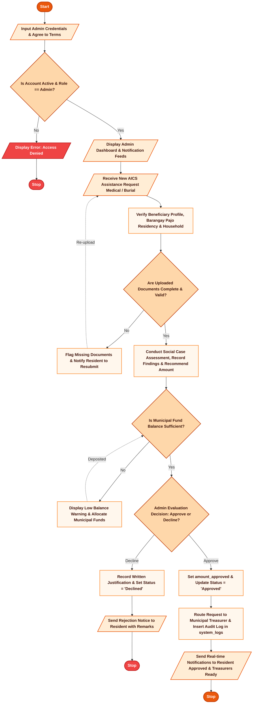

---

## 🗺️ 2. Master Administrator System Architecture Flow

The following master flowchart depicts the end-to-end lifecycle and modules managed exclusively or primarily by the Administrator.

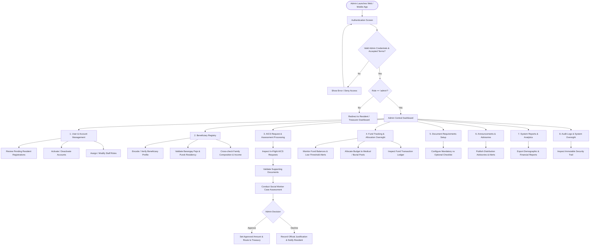

---

## 🔐 2. Module 1: Administrator Authentication & Session Security Flow

Administrators authenticate with encrypted email and password credentials, subject to role verification and mandatory Terms & Conditions acknowledgement.

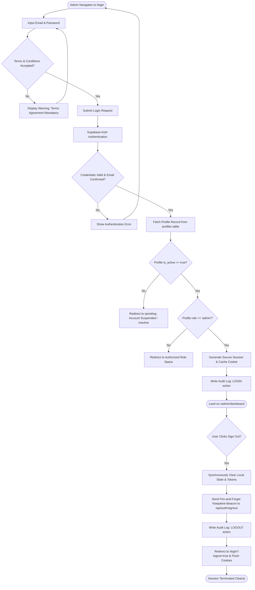

---

## 👥 3. Module 2: User Account & Staff Management Flow

Administrators hold exclusive authority to activate newly registered residents, suspend accounts, and configure system staff (Admins, Treasurers).

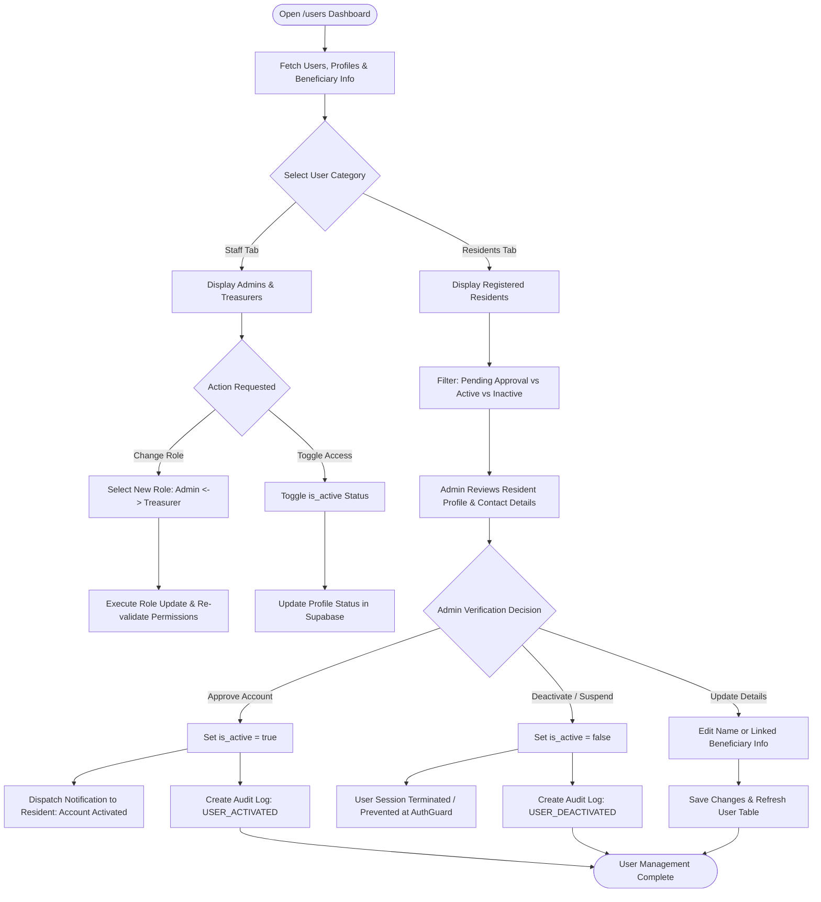

---

## 🗂️ 4. Module 3: Beneficiary Registry & Profiling Flow

Every AICS assistance application requires a linked beneficiary. Administrators can directly encode beneficiaries or inspect and verify resident self-registered profiles.

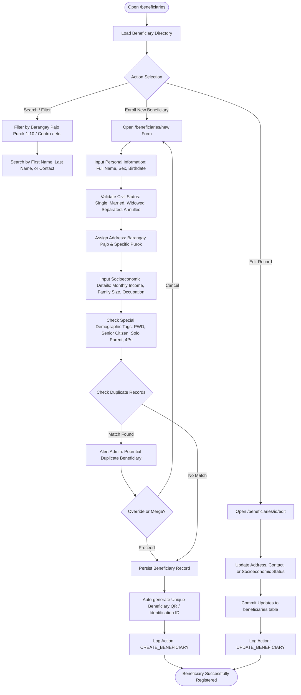

---

## ⚖️ 5. Module 4: AICS Assistance Request Processing & Assessment Flow

This is the core operational workflow of the MSWD. It covers the end-to-end evaluation of requests from initial submission to social assessment, decision-making, and referral to the Municipal Treasurer.

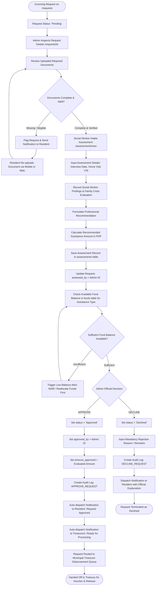

---

## 💰 6. Module 5: Fund Allocation & Treasury Oversight Flow

The Administrator manages the municipal budget pool, monitors expenditures, and allocates resources to Medical and Burial assistance categories.

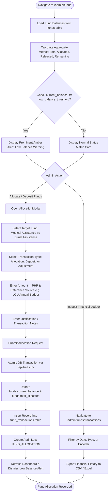

---

## ⚙️ 7. Module 6: Requirements Configuration Flow

Administrators can dynamically tailor the mandatory documents required for each assistance type without modifying application source code.

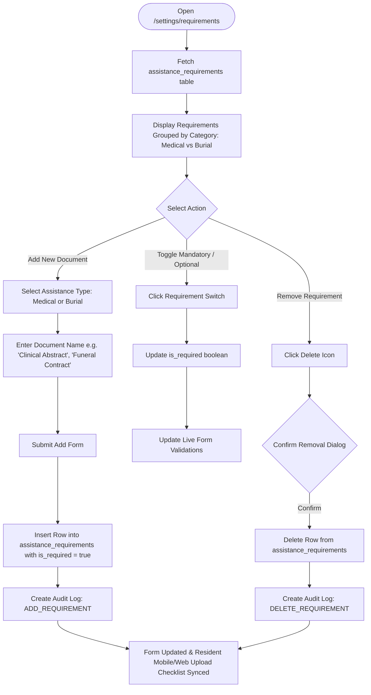

---

## 📢 8. Module 7: Announcements & Public Advisories Flow

The Administrator broadcasts important updates, payout distribution dates, and calamity advisories to residents.

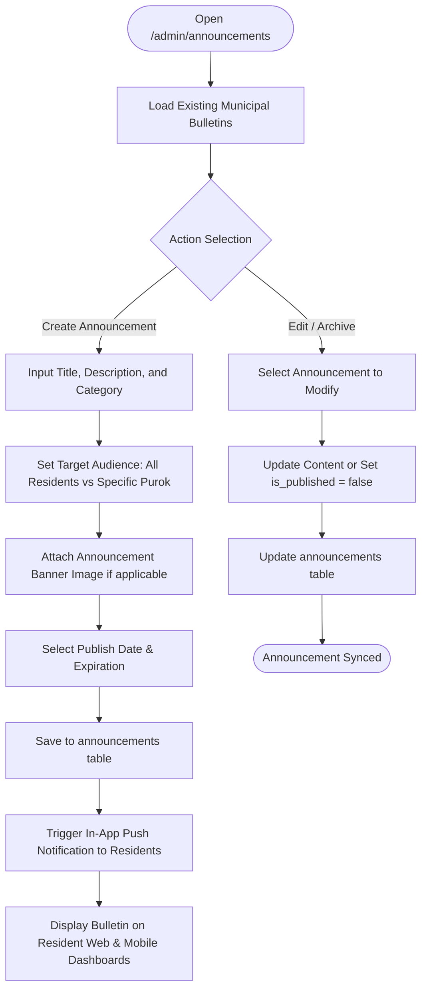

---

## 📊 9. Module 8: System Reports & DSWD Analytics Flow

Administrators generate official compliance reports for submission to the Daanbantayan Municipal Council, Mayor's Office, and the DSWD Regional Office.

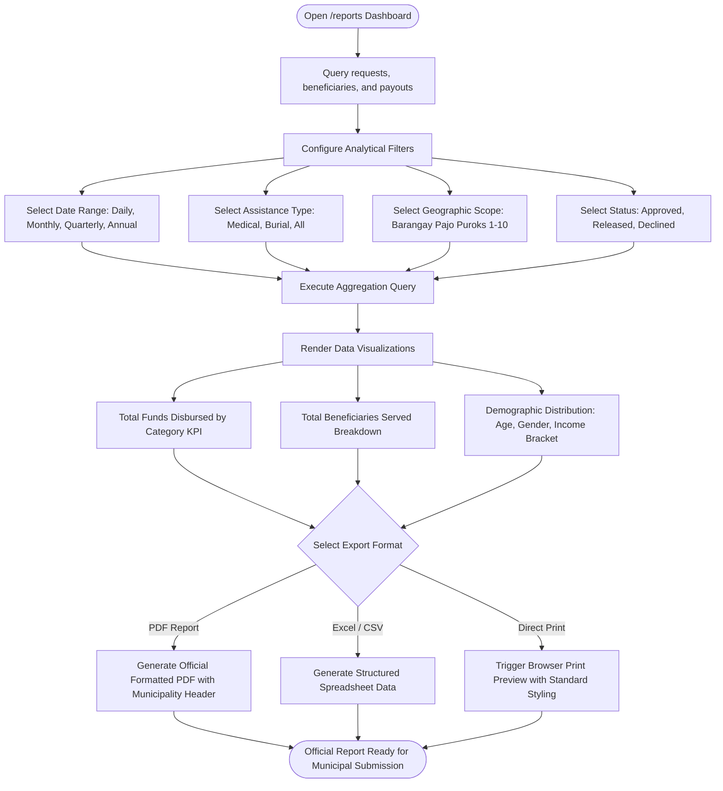

---

## 🛡️ 10. Module 9: System Audit Logging & Security Oversight Flow

To ensure complete transparency and prevent fraud, every action performed by any role (Admin, Treasurer, Resident) is audited. The Administrator possesses exclusive access to inspect these system logs.

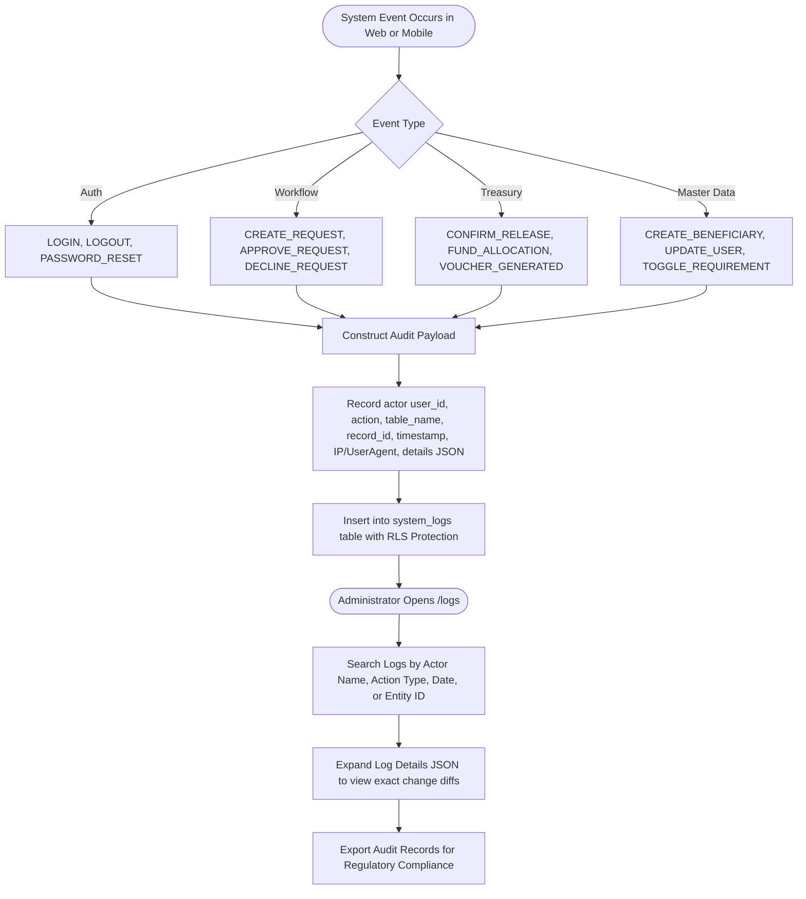

---

## 🏊 11. Cross-Functional Swimlane Diagram (Administrator Central Role)

This swimlane demonstrates how the Administrator interacts with the Resident, the System Engine, and the Municipal Treasurer throughout an AICS transaction.

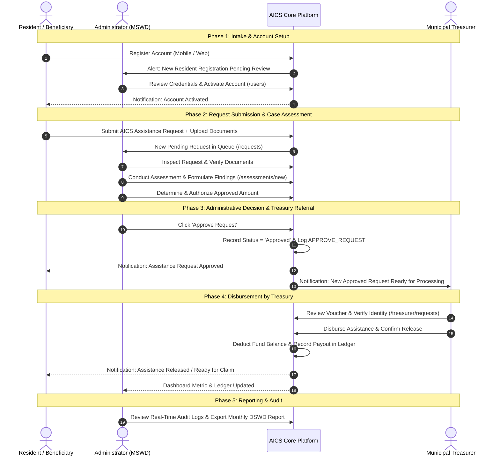

---

## 📈 12. Request Status State Machine (Admin Governance)

The table below summarizes the exact state transitions governed by the Administrator:

| Initial State | Trigger / Action by Admin | Target State | Fund Impact | Notification Triggered |
| :--- | :--- | :--- | :--- | :--- |
| **Draft / Submitted** | System validates submission | **Pending** | None | Admin notified of incoming request |
| **Pending** | Admin conducts assessment & approves | **Approved** | Pre-encumbered | Resident & Treasurer notified |
| **Pending** | Admin rejects with formal reason | **Declined** | None | Resident notified with justification |
| **Approved** | Treasurer processes disbursement | **Released** | Current balance deducted | Resident notified of release |
| **Approved** | Treasurer flags discrepancy to Admin | **Pending** *(Returned)* | Returned to pool | Admin notified with return remarks |

---

## 📌 Document Control & Sign-off

- **Document Code**: `DOC-AICS-FLOW-ADMIN-001`
- **Target Audience**: Municipal Social Welfare and Development Officers (MSWDO), IT Administrators, Project Auditors.
- **System**: AICS Request Management and Beneficiary Information System
- **Municipality**: Municipality of Daanbantayan, Province of Cebu
- **Version**: 1.0.0
- **Status**: Official System Specification
